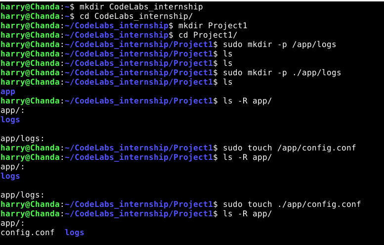
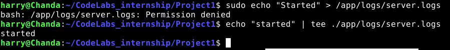
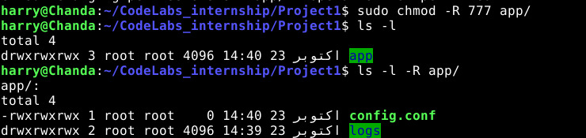
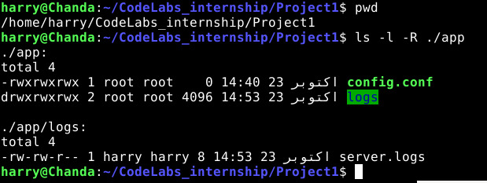
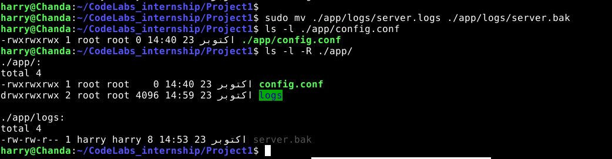

# DecodeLabs Internship — Project 1: Linux File System & Permissions Management

Welcome to the documentation for **Project 1** of the DecodeLabs Internship. This project covers essential Linux terminal commands, file system hierarchy, permission management using `chmod`, I/O stream redirection (`tee`), and file backup/renaming (`mv`).

---

## 📁 Project Directory Structure

```text
Project1/
├── README.md
├── app/
│   ├── config.conf
│   └── logs/
│       └── server.bak
└── ScreenShots/
    ├── 1.jpeg
    ├── 2.jpeg
    ├── 3.jpeg
    ├── 4.jpeg
    └── 5.jpeg
```

---

## 🛠️ Step-by-Step Task Breakdown & Screenshots

### Step 1: Directory Hierarchy & Configuration File Setup
Setting up the project structure and nested directories for application logs and configuration.



#### Commands Executed:
* `mkdir CodeLabs_internship && cd CodeLabs_internship/`: Creates and navigates into the main internship repository.
* `mkdir Project1 && cd Project1/`: Creates and navigates into the Project 1 workspace directory.
* `sudo mkdir -p ./app/logs`: Uses `-p` (parents) flag to safely create parent directory `app` and nested directory `logs` simultaneously.
* `sudo touch ./app/config.conf`: Creates an empty configuration file inside the `./app` directory.
* `ls -R app/`: Recursively lists directories and files to verify hierarchy.

---

### Step 2: Stream Redirection & Writing to Privileged Files
Writing log output to a file and handling root shell permissions correctly.



#### Commands Executed:
* `sudo echo "Started" > /app/logs/server.logs`  
  * **Error**: `bash: /app/logs/server.logs: Permission denied`
  * **Root Cause**: The shell redirection (`>`) is evaluated by the user shell *before* `sudo` executes. Additionally, `/app` points to the root filesystem rather than the local project directory.
* `echo "started" | tee ./app/logs/server.logs`  
  * **Solution**: Piped standard output into `tee`, successfully writing `"started"` to `./app/logs/server.logs` and printing it to the terminal screen.

---

### Step 3: Absolute Path Verification & Deep Inspection
Checking current location in the filesystem and validating file permissions, sizes, and ownership.



#### Commands Executed:
* `pwd`: **P**rint **W**orking **D**irectory confirms absolute path `/home/harry/CodeLabs_internship/Project1`.
* `ls -l -R ./app`:
  * `-l`: Displays long format (permissions, ownership, size, timestamp).
  * `-R`: Recursively inspects subfolders.
  * Verifies `config.conf` (size: 0 bytes), `logs/` directory, and `server.logs` (size: 8 bytes, user: `harry:harry`).

---

### Step 4: Modifying File and Directory Permissions (`chmod`)
Setting read, write, and execute permissions across the application folder tree.



#### Commands Executed:
* `sudo chmod -R 777 app/`:
  * `chmod`: Change mode (permissions).
  * `-R`: Recursive flag applying changes to `app/` and all nested files and subfolders.
  * `777`: Full permissions (`rwx` = Read: 4, Write: 2, Execute: 1 → 4+2+1=7) for Owner, Group, and Others.
* `ls -l` & `ls -l -R app/`: Verifies updated permission bits (`drwxrwxrwx` and `-rwxrwxrwx`).

---

### Step 5: File Renaming & Backup Creation
Renaming active log file to `.bak` extension for backup/archival purposes.



#### Commands Executed:
* `sudo mv ./app/logs/server.logs ./app/logs/server.bak`:
  * Renames / moves `server.logs` to `server.bak`.
* `ls -l ./app/config.conf`: Checks configuration file attributes.
* `ls -l -R ./app/`: Verifies `server.logs` is now successfully saved as `server.bak`.

---

## 📋 Complete Linux Commands Reference

| Command | Flags / Arguments | Description |
| :--- | :--- | :--- |
| `mkdir` | `CodeLabs_internship`, `Project1` | Creates a new directory. |
| `mkdir` | `-p ./app/logs` | Creates parent and nested subdirectories without error if they already exist. |
| `cd` | `<directory>` | Changes current working directory. |
| `touch` | `./app/config.conf` | Creates an empty file or updates timestamp. |
| `ls` | `-R` | Recursively lists all subdirectories and contents. |
| `ls` | `-l` | Displays detailed listing format (permissions, owner, size, date). |
| `chmod` | `-R 777 app/` | Recursively grants full read, write, and execute permissions to all users. |
| `echo` | `"started"` | Prints text to standard output. |
| `tee` | `./app/logs/server.logs` | Reads from stdin and writes to standard output and file simultaneously. |
| `pwd` | — | Prints the current working directory's absolute path. |
| `mv` | `<source> <destination>` | Renames or moves a file / directory. |
| `sudo` | — | Executes commands with superuser (root) privileges. |
